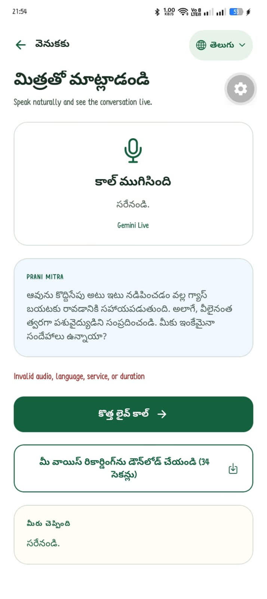
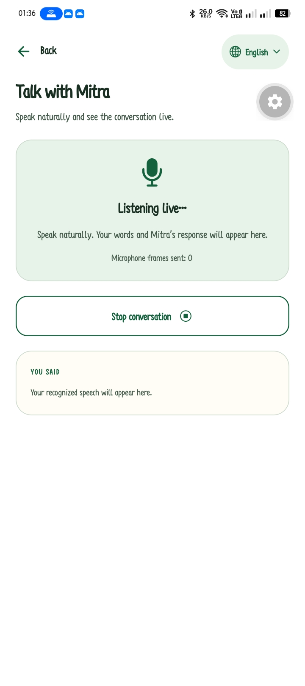
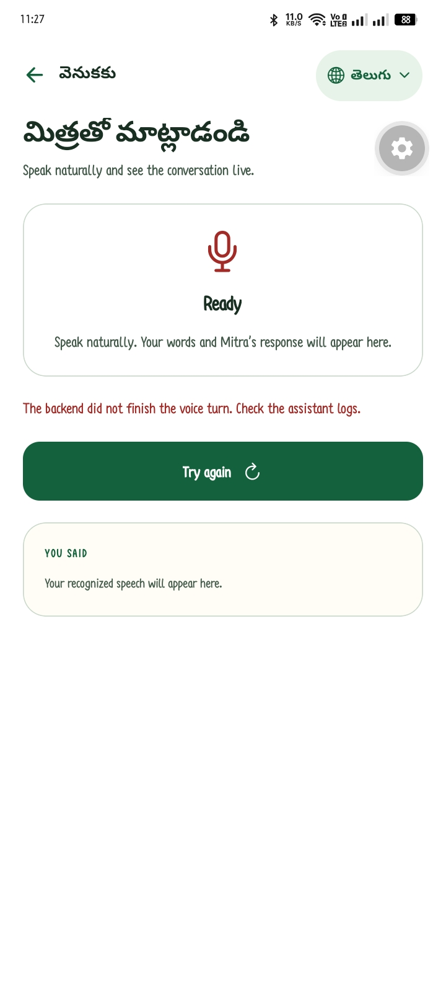

# Prani Mitra

## Multilingual AI Voice Assistant for Farmers

Prani Mitra is a mobile-first AI assistant for Indian farmers. It helps farmers communicate naturally in English, Hindi, or Telugu and receive practical guidance about crops, livestock, nutrition, government schemes, and general farming questions.

The application combines voice technology, farming-focused reasoning, urgency detection, verified support contacts, and multilingual notifications in one simple experience.

## 1. Project summary

### Project title

**Prani Mitra – Multilingual AI Voice Assistant for Farmers**

### Target users

- Small and marginal farmers
- Dairy and livestock farmers
- Poultry farmers
- Farmers with limited digital literacy
- Telugu and Hindi speaking rural communities
- Farmers who prefer speaking instead of typing

## 2. Problem statement

Farmers often struggle to access timely and understandable agricultural guidance. Expert help may be far away, online information may be difficult to interpret, and many digital services are not designed for local languages or voice interaction.

Animal-health problems can become serious when the farmer does not know which symptoms matter or when to contact a veterinarian. Government-scheme information can also be difficult to find and verify.

Prani Mitra addresses these problems through a local-language, voice-first interface that converts farmer speech into useful, actionable guidance.


### Challenge addressed

How can an AI system make agricultural and animal-health assistance easier to access for farmers who prefer speaking in their local language?

### Our approach

Prani Mitra combines a multilingual mobile interface, streaming voice interaction, speech recognition, farming-focused reasoning, text-to-speech, urgency detection, and verified support contacts.

The farmer can explain a problem naturally. The system understands the selected farming context, asks relevant follow-up questions, gives a clear response, summarizes the conversation, and recommends immediate action when required.

### Demonstrated outcome

The prototype demonstrates an end-to-end farmer-support workflow:

```text
Farmer speaks
    → Speech is transcribed
    → Farming context is applied
    → Gemini reasons about the problem
    → Response is shown and spoken
    → Conversation is summarized
    → Urgency is detected
    → Verified support contacts can be called
```

### Why this is suitable for a hackathon

- It solves a clear real-world problem.
- It uses AI models for distinct, practical responsibilities.
- It supports regional languages instead of English-only interaction.
- It demonstrates a complete user flow instead of an isolated model call.
- It includes safety rules for animal-health situations.
- It can be extended with official agriculture, weather, and government data.

## 3. Proposed solution

The farmer selects a language and service, then speaks naturally. Prani Mitra:

1. Captures the farmer’s voice.
2. Converts speech to text.
3. Understands the farming context.
4. Asks relevant follow-up questions.
5. Provides a concise response.
6. Summarizes completed conversations.
7. Detects warning or urgent situations.
8. Shows verified support contacts when required.
9. Reads the response aloud.
10. Saves useful analysis history for later review.

## 4. Supported languages

- English (`en-IN`)
- Hindi (`hi-IN`)
- Telugu (`te-IN`)

Language selection affects:

- Screen text
- Voice prompts
- Speech recognition language
- Gemini response language
- Text-to-speech language
- Daily reminder notification language
- Urgency and support messages

## 5. Main user journeys

### 5.1 First launch

```text
Welcome screen
    → Login or registration
    → Select language
    → Welcome to Prani Mitra
    → Home screen
```

### 5.2 Live voice conversation

```text
Assistant tab
    → Select service
    → Start conversation
    → Prani Mitra call screen
    → Farmer speaks
    → Live speech appears in the center area
    → Mitra responds with text and audio
    → End call
    → Automatic recording analysis
```

The active call screen displays:

- Prani Mitra identity
- Live listening/reply state
- Farmer’s speech
- Assistant response
- End call control
- Conversation transcript
- Downloadable recording

### 5.3 Recorded-audio analysis

```text
Analyze a recording
    → Record audio
    → Stop recording
    → Speech transcription
    → Gemini analysis
    → Summary and immediate action
    → Optional TTS playback
    → Save to analysis history
```

### 5.4 Urgent support

```text
Gemini detects warning or urgent situation
    → Backend checks verified contacts
    → App opens contact popup
    → Farmer sees name, phone, category, and distance
    → Farmer can call directly
```

The app must never show invented phone numbers as real contacts.

### 5.5 Daily reminder

The app schedules a local notification at 8:00 AM using the farmer’s name and selected language.

Example Telugu message:

```text
నమస్తే రమేష్
ఎలా ఉన్నారు? మీ పశువులు మరియు పంటలు ఎలా ఉన్నాయి?
```

This reminder is local to the device and does not require a backend request.

## 6. Selected product screenshots

These are the only screenshots needed for a project submission. They show the multilingual interface, live voice experience, call-style design, and post-call analysis.

### Multilingual Telugu analysis screen

Shows the Telugu interface, assistant response, recognized speech, recording download, and analysis result area.



### Prani Mitra call-style voice experience

Shows the Prani Mitra identity, large conversation area, and end-call controls without any personal name or phone number.


### Live voice conversation

Shows the active microphone state and the area where the farmer’s speech and Mitra’s response appear live.



### Urgent analysis and next action

Shows a completed voice response, immediate action, and the point where verified support contacts can be presented for warning or urgent cases.



## 7. AI architecture

For a concise technology list, see [TECHNOLOGIES_USED.md](TECHNOLOGIES_USED.md).

```text
Expo mobile app
    │
    ├── Microphone audio
    ├── Language and service context
    └── Authentication token
            │
            ▼
Prani Mitra backend
    │
    ├── Gnani Prisma: speech-to-text
    ├── Gemini: reasoning, questions, summary, urgency
    ├── Gnani Timbre: text-to-speech
    ├── Verified contacts database
    └── Analysis history database
            │
            ▼
Expo app response
    ├── Transcript
    ├── Progressive assistant response
    ├── Summary
    ├── Immediate action
    ├── Urgent contact popup
    └── Audio playback
```

### Model responsibilities

#### Gnani Prisma

- Convert English, Hindi, and Telugu speech to text.
- Accept the recorded PCM16 mono 16 kHz audio sent by the app.
- Return a final transcript for analysis.

#### Gemini

- Understand the selected service context.
- Ask relevant follow-up questions.
- Generate farming guidance.
- Summarize completed audio.
- Identify immediate action.
- Classify urgency as `normal`, `warning`, or `urgent`.
- Decide whether verified support contact is required.

#### Gnani Timbre

- Convert the assistant response to audio.
- Speak in the selected language.
- Return audio in a format supported by the Expo player.

### Implementation technologies

#### Mobile application

- Expo SDK 58
- React Native
- TypeScript
- Expo Router
- NativeWind and React Native styles
- Expo Audio for microphone capture and playback
- Expo File System and Expo Sharing for recording export
- Expo Notifications for daily reminders
- Expo Location for nearby-contact support
- Expo Secure Store for authentication tokens
- AsyncStorage for local profile, language, and conversation state

#### Backend integration

- Node.js backend
- REST API endpoints
- WebSocket support for live voice sessions
- JWT authentication
- Database persistence for users, recordings, analyses, and verified contacts
- CORS configuration for the Expo web client

#### Artificial intelligence services

- Gnani Prisma Speech-to-Text
- Gemini Live for real-time voice interaction
- Gemini reasoning for farming guidance and analysis
- Gnani Timbre Text-to-Speech

#### Build and deployment

- EAS Build
- Android APK distribution
- Render-compatible backend deployment
- Environment-based configuration for development, preview, and production

#### Testing and quality checks

- TypeScript type checking
- Expo ESLint
- Realtime protocol tests
- Localization coverage tests
- Manual APK testing on a physical Android device

## 8. Service contexts

The app supports these service contexts:

### Animal health

Symptoms, appetite, drinking, movement, breathing, vaccination planning, dairy animals, livestock care, and veterinary referrals.

### Crop guidance

Crop planning, soil health, irrigation, pests, diseases, weather observations, and harvest preparation.

### Nutrition and feed

Feed routines, animal age, species, production stage, feed quantity, leftovers, and feed-cost tracking.

### Government schemes

Eligibility questions, application preparation, required documents, local offices, and official-information verification.

### General questions

Prani Mitra usage, language support, phone support, account help, and general farming questions.

## 9. Conversation behavior requirements

The assistant should:

- Listen until the farmer finishes speaking.
- Wait approximately three seconds after speech ends before responding.
- Cancel a pending response if the farmer starts speaking again.
- Pause microphone processing while the assistant is speaking.
- Resume listening after the response audio completes.
- Ask one or two important follow-up questions at a time.
- Avoid unnecessary questions.
- Use the selected language consistently.
- Repeat important immediate actions clearly.

### Animal-health follow-up questions

- What symptoms are visible?
- Is the animal eating and drinking?
- Is the animal breathing normally?
- Is there fever, swelling, bleeding, diarrhea, or unusual behavior?
- When did the problem start?
- Are other animals affected?

### Crop follow-up questions

- What is the crop and variety?
- How old is the crop?
- How much of the field is affected?
- When did the symptoms appear?
- What is visible on the leaves or stem?
- What were the recent irrigation, rain, and pest conditions?

## 10. Safety requirements

Prani Mitra is a guidance tool and does not replace qualified professionals.

- Do not claim a medical or veterinary diagnosis.
- Do not prescribe unsafe medication or dosage.
- Recommend a qualified veterinarian for serious animal symptoms.
- Recommend official sources for current government-scheme rules.
- Never invent emergency phone numbers.
- Show contacts only when `verified: true` in the backend database.
- Do not expose API keys in the Expo app.
- Do not log full audio, private transcripts, JWT tokens, or API keys.

## 11. Backend API contract

### 10.1 Live token

```text
POST /api/assistant/live-token
Authorization: Bearer <Prani-Mitra-JWT>
```

The backend uses the server-only Gemini key to provision a short-lived Gemini Live token. The Gemini key must never be sent to the client.

### 10.2 Recording analysis

```text
POST /api/assistant/analyze-recording
Authorization: Bearer <Prani-Mitra-JWT>
Content-Type: application/json
```

Request:

```json
{
  "audioBase64": "<base64 PCM16 mono 16kHz audio>",
  "language": "Telugu",
  "service": "animal-health",
  "duration": 34
}
```

Accepted languages:

```text
English, Hindi, Telugu, हिन्दी, తెలుగు
```

Normalize them as:

```text
English → en-IN
Hindi or हिन्दी → hi-IN
Telugu or తెలుగు → te-IN
```

Accepted services:

```text
animal-health
farming
nutrition
schemes
general
```

Response:

```json
{
  "success": true,
  "data": {
    "id": "analysis-id",
    "language": "Telugu",
    "service": "animal-health",
    "transcript": "The farmer's transcript",
    "summary": "Summary of the conversation",
    "immediateAction": "Contact a veterinarian soon",
    "urgency": "warning",
    "requiresContact": true,
    "contactReason": "The animal may need professional assessment",
    "response": "Please check these symptoms and contact a veterinarian if they continue.",
    "contacts": [
      {
        "name": "Verified Veterinary Doctor",
        "phone": "+919999999999",
        "distanceKm": 2.4,
        "category": "veterinarian"
      }
    ],
    "audioBase64": "<base64 TTS audio or null>",
    "audioFormat": "wav",
    "audioSampleRate": 24000,
    "duration": 34,
    "createdAt": "2026-11-08T00:00:00.000Z"
  }
}
```

If TTS fails after STT and Gemini succeed, return the analysis with `audioBase64: null` and do not fail the complete request.

### 10.3 Analysis history

```text
GET /api/assistant/recordings
Authorization: Bearer <Prani-Mitra-JWT>
```

Response:

```json
{
  "success": true,
  "data": {
    "items": []
  }
}
```

### 10.4 Nearby contacts

The analysis response may include contacts directly. If contact lookup is separate, support:

```text
GET /api/support/nearby?latitude=<number>&longitude=<number>&category=veterinarian
Authorization: Bearer <Prani-Mitra-JWT>
```

Only verified contacts may be returned. The endpoint should return up to five contacts sorted by distance and return `distanceKm: null` when location is unavailable.

## 12. Backend environment variables

Keep these values only in the backend deployment environment:

```env
GEMINI_API_KEY=replace-with-server-secret
GEMINI_MODEL=replace-with-supported-model
GEMINI_LIVE_MODEL=replace-with-supported-live-model
GNANI_API_KEY=replace-with-server-secret
GNANI_PRISMA_ENDPOINT=replace-with-provider-endpoint
GNANI_TIMBRE_ENDPOINT=replace-with-provider-endpoint
DATABASE_URL=replace-with-database-connection
JWT_SECRET=replace-with-server-secret
GNANI_WEBHOOK_SECRET=replace-with-webhook-secret
ASSISTANT_ALLOWED_ORIGINS=https://your-web-app.example
```

Never place these values in `EXPO_PUBLIC_*` variables.

## 13. Expo environment variables

The Expo app may expose only public URLs and public widget configuration:

```env
EXPO_PUBLIC_API_URL=https://your-backend.example/api
EXPO_PUBLIC_GEMINI_TOKEN_URL=https://your-backend.example/api/assistant/live-token
EXPO_PUBLIC_MSG91_WIDGET_ID=your-widget-id
EXPO_PUBLIC_MSG91_TOKEN_AUTH=your-mobile-integration-token
```

Gemini and Gnani provider API keys must not be added to the Expo environment.

## 14. Required app permissions

The production app requests:

### Android

- `RECORD_AUDIO`
- `MODIFY_AUDIO_SETTINGS`
- `ACCESS_COARSE_LOCATION`
- `ACCESS_FINE_LOCATION`
- `POST_NOTIFICATIONS`

### iOS

- Microphone usage description
- Location when-in-use description
- Notification usage description

Users must grant microphone permission for voice conversations, location permission for nearby contacts, and notification permission for daily reminders.

## 15. Repository implementation map

Important frontend files:

```text
src/app/voice.tsx                    Live call screen and automatic analysis
src/app/recording-analysis.tsx       Recorded-audio analysis screen
src/app/analysis-history.tsx         Saved analysis history
src/components/UrgencyContactsModal.tsx  Urgent contact popup
src/services/api.ts                  Backend API contracts
src/services/realtimeAssistant.ts    Gemini Live connection
src/services/voicePlayback.ts        TTS and PCM/WAV playback
src/services/dailyNotification.ts    Daily 8 AM local notification
src/context/AppContext.tsx           Profile, language, and local state
src/i18n/index.ts                    English, Hindi, and Telugu translations
src/data/content.ts                  Services, articles, and FAQs
app.json                             Native permissions and Expo plugins
eas.json                             Development, preview, and production builds
scripts/test-realtime.cjs            Realtime protocol tests
scripts/test-localization.cjs        Localization coverage tests
```

## 16. Local development

Install dependencies:

```powershell
npm install
```

Start the Expo project:

```powershell
npx expo start
```

Run web:

```powershell
npm run web
```

Run validation:

```powershell
npx tsc --noEmit
npx expo lint
npm test
```

## 17. APK builds

### Repository and build links

- Backend repository: [Prani Mitra Backend1](https://github.com/Hemasundar2006/Prani-Mitra-Backend1)
- Frontend repository: not available in the current app folder because no GitHub remote is configured.
- Latest preview APK build: [Open the build on Expo](https://expo.dev/accounts/marothihemasundar03/projects/pranimitra/builds/95d7760e-9f28-43aa-8133-43e0882a608e)

### Latest preview APK build

[Open the latest Prani Mitra preview build on Expo](https://expo.dev/accounts/marothihemasundar03/projects/pranimitra/builds/95d7760e-9f28-43aa-8133-43e0882a608e)

Preview APK:

```powershell
npx eas-cli@latest build --platform android --profile preview
```

Production APK:

```powershell
npx eas-cli@latest build --platform android --profile production-apk
```

The preview and production-apk profiles produce installable Android APK files.

After changing native permissions, plugins, audio, location, or notifications, a new APK build is required. Expo Go cannot represent every production native capability.

## 18. Testing checklist

### Authentication

- Register with a valid mobile number.
- Login with password.
- Login with OTP.
- Test Hindi and Telugu registration preferences.
- Verify invalid credentials show translated errors.

### Localization

- Switch to English.
- Switch to Hindi.
- Switch to Telugu.
- Visit every tab and detail screen.
- Confirm service names, buttons, errors, FAQs, article text, voice statuses, and notifications change language.

### Voice conversation

- Grant microphone permission.
- Start a live call.
- Confirm the call-style screen opens.
- Confirm farmer speech appears in the center area.
- Confirm assistant response appears progressively.
- Confirm assistant audio plays.
- Confirm End Call stops microphone capture.
- Confirm analysis starts after ending the call.

### Analysis

- Confirm transcript is returned.
- Confirm summary is returned.
- Confirm immediate action is returned.
- Test normal, warning, and urgent results.
- Confirm TTS failure does not remove the analysis.
- Confirm history contains the saved analysis.

### Emergency contacts

- Test warning urgency.
- Test urgent urgency.
- Confirm popup opens only when `requiresContact` is true.
- Confirm only verified contacts are displayed.
- Confirm phone numbers use international format.
- Tap Call now and verify the phone dialer opens.
- Test no-contact response.

### Notifications

- Grant notification permission.
- Confirm the daily reminder is scheduled for 8:00 AM.
- Test English, Hindi, and Telugu reminder text.
- Reopen the app and confirm the reminder is not duplicated.

## 19. Competition-ready explanation

### What makes Prani Mitra different?

Prani Mitra is designed around how many farmers actually communicate: by speaking in their own language. It combines multilingual voice interaction with farming context, animal-health safety guidance, urgency detection, verified support contacts, and follow-up analysis.

It does not only answer a question. It helps the farmer explain a problem, asks for the missing details, identifies the next action, and helps connect the farmer with support when necessary.

### Why voice matters

Voice reduces the need for typing, improves accessibility for users with limited digital literacy, and allows farmers to explain symptoms and field conditions naturally.

### Why multilingual support matters

Advice is more useful when it is delivered in the language the farmer understands best. Prani Mitra keeps the selected language consistent across the interface, speech recognition, reasoning, speech output, and notifications.

### Measurable impact goals

- Reduce the time needed to find initial farming guidance.
- Improve the quality of information shared with veterinarians.
- Increase access to agricultural information in regional languages.
- Help farmers recognize when professional help is needed.
- Make voice-based digital assistance easier for rural users.

## 20. Current limitations and next improvements

- Provider-specific Gnani endpoint contracts must be confirmed against the active Gnani account.
- Nearby contacts require verified database records.
- Gemini responses require internet access.
- Native audio and notification behavior should be verified on a release APK, not only Expo Go.
- Government-scheme answers should be connected to current official sources before public launch.
- A human expert escalation workflow can be added for high-risk cases.

## 21. Final project statement

Prani Mitra is a safe, multilingual, voice-first AI companion for farmers. It brings together speech recognition, farming intelligence, text-to-speech, urgency detection, verified emergency contacts, and daily support reminders in a mobile experience designed for Indian rural communities.

The project focuses on a simple outcome: help a farmer speak naturally, understand the next step, and reach the right support at the right time.
